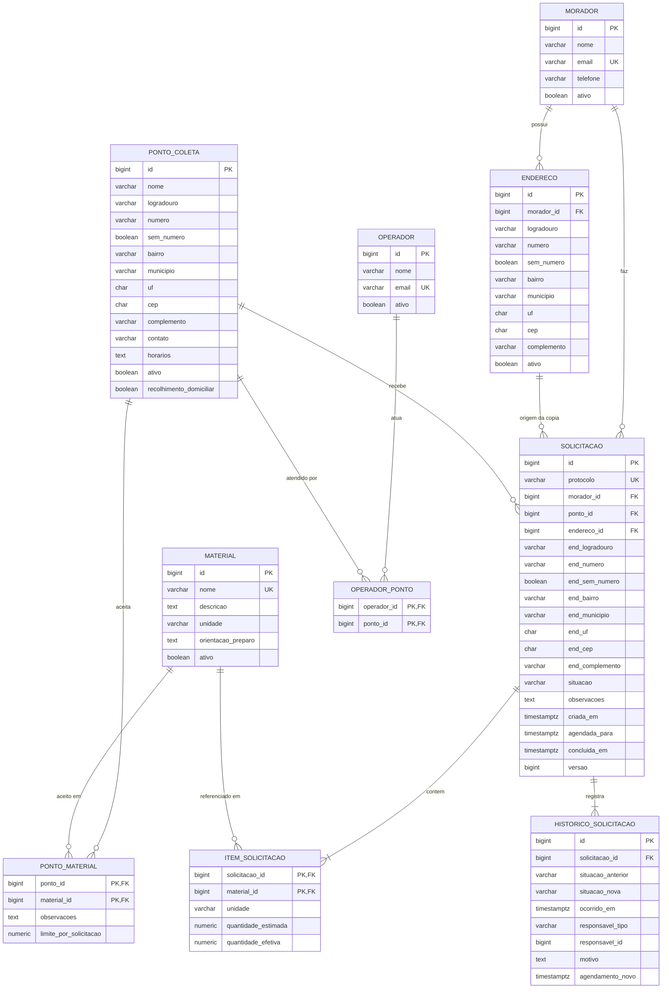

# DER - Coleta Seletiva

Modelo relacional da primeira unidade (issue #2, PLAN-02). Requisitos cobertos: seção 10 do PDF, RN01-RN06 e RNF05.

**Situação:** implementado nas migrações `V1` a `V6` (issue #5, API-02). Os acréscimos feitos na implementação estão marcados como **decisão** e justificados no [Registro de decisões da API-02](documentos-issues/issue-api-02/Registro_de_decisoes.md).

**Critério usado:** entra o que o PDF pede. Itens que o PDF não cita, mas que são necessários, estão marcados como **decisão** no dicionário de dados, com o motivo. Justificativas e consequências completas: [Registro de decisões](documentos-issues/issue-02/Registro_de_decisoes.md).

## Diagrama

## Cardinalidades

| Relação | Cardinalidade | Origem |
| --- | --- | --- |
| Morador - Endereço | 1:N | Seção 10 ("possui vários endereços"); RF02 ("único proprietário") |
| Morador - Solicitação | 1:N | Seção 10 ("possui vários [...] solicitações") |
| Endereço - Solicitação | 1:N | **Decisão:** FK de origem, além da cópia |
| Ponto - Material | N:N via `PONTO_MATERIAL` | RF05 ("vários materiais a cada ponto") |
| Operador - Ponto | N:N via `OPERADOR_PONTO` | Seção 10 ("vínculos com pontos"); RF07 |
| Ponto - Solicitação | 1:N | Seção 10 (solicitação tem ponto) |
| Solicitação - Item | 1:N, mínimo 1 | RF08 ("pelo menos um item") |
| Material - Item | 1:N | Seção 10 (item tem material) |
| Solicitação - Histórico | 1:N, mínimo 1 | Seção 13 ("histórico inicial" na criação) |

## Dicionário de dados

### MORADOR
| Campo | Tipo | Restrição | Origem |
| --- | --- | --- | --- |
| id | bigint | PK | Seção 10 |
| nome | varchar(120) | NOT NULL | Seção 10; RF01 ("exigir nome") |
| email | varchar(160) | NOT NULL, UNIQUE | RF01 (e-mail único após normalização: minúsculo e sem espaços, feito no Service) |
| telefone | varchar(20) | | Seção 10; RF01 |
| ativo | boolean | NOT NULL, default true | RN03 (inativar em vez de excluir) |

### ENDERECO
| Campo | Tipo | Restrição | Origem |
| --- | --- | --- | --- |
| id | bigint | PK | Seção 10 |
| morador_id | bigint | FK morador, NOT NULL | Seção 10; RF02 (um único proprietário) |
| logradouro | varchar(150) | NOT NULL | RF02 |
| numero | varchar(10) | nulo só se sem_numero | RF02 (texto por causa de "10A") |
| sem_numero | boolean | NOT NULL, default false | RF02 ("indicação de sem número") |
| bairro | varchar(80) | NOT NULL | RF02 |
| municipio | varchar(80) | NOT NULL | RF02 |
| uf | char(2) | NOT NULL | RF02 |
| cep | char(8) | NOT NULL | RF02 (texto: pode começar com zero) |
| complemento | varchar(80) | | RF02 (opcional) |
| ativo | boolean | NOT NULL, default true | **Decisão:** como a solicitação referencia o endereço, ele é inativado em vez de excluído |

Restrição: `CHECK (sem_numero OR numero IS NOT NULL)` (RF02: endereço incompleto é rejeitado).

### MATERIAL
| Campo | Tipo | Restrição | Origem |
| --- | --- | --- | --- |
| id | bigint | PK | Seção 10 |
| nome | varchar(80) | NOT NULL, UNIQUE | RF03 (nome duplicado é rejeitado) |
| descricao | text | | RF03 |
| unidade | varchar(10) | NOT NULL, CHECK (KG, LITRO, UNIDADE) | RF03; RN02 (peso, volume e peça) |
| orientacao_preparo | text | | RF03 |
| ativo | boolean | NOT NULL, default true | RF03 ("inativar"); seção 10 ("situação") |

Na API-05, a migração V7 acrescenta `idx_material_nome_normalizado`, índice único sobre `LOWER(BTRIM(nome))`. O nome mantém a apresentação, mas variações de caixa e espaços nas pontas não criam outro material, inclusive após inativação. As migrações V1 a V6 e os dados existentes são preservados. Se já houver duplicatas por essa nova comparação, elas precisam ser revisadas antes da migração; ela não apaga nem escolhe um cadastro automaticamente.

### PONTO_COLETA
| Campo | Tipo | Restrição | Origem |
| --- | --- | --- | --- |
| id | bigint | PK | Seção 10 |
| nome | varchar(120) | NOT NULL | RF04 (ponto sem nome é rejeitado) |
| logradouro, numero, sem_numero, bairro, municipio, uf, cep, complemento | mesmos tipos de ENDERECO | logradouro, bairro, municipio, uf e cep NOT NULL | RF04 (ponto sem endereço é rejeitado); seção 10 permite embutir. Colunas separadas porque a RF06 filtra por município e bairro |
| contato | varchar(120) | | RF04 |
| horarios | text | | RF04 |
| ativo | boolean | NOT NULL, default true | RF04 ("situação"); RN03 |
| recolhimento_domiciliar | boolean | NOT NULL | RF04; RN01 |

Restrição: `CHECK (sem_numero OR numero IS NOT NULL)`. **Decisão:** mesma regra do endereço, para o campo `sem_numero` ter efeito (decisão 1.5 do [Registro da API-02](documentos-issues/issue-api-02/Registro_de_decisoes.md)).

### PONTO_MATERIAL
| Campo | Tipo | Restrição | Origem |
| --- | --- | --- | --- |
| ponto_id | bigint | PK composta, FK ponto | RF05 |
| material_id | bigint | PK composta, FK material | RF05 |
| observacoes | text | | RF05 |
| limite_por_solicitacao | numeric(12,3) | nulo ou > 0 | RF05 ("eventual limite"; rejeitar ≤ 0) |

A PK composta `(ponto_id, material_id)` impede repetir o vínculo (RF05).

### OPERADOR
| Campo | Tipo | Restrição | Origem |
| --- | --- | --- | --- |
| id | bigint | PK | Seção 10 |
| nome | varchar(120) | NOT NULL | Seção 10 |
| email | varchar(160) | NOT NULL, UNIQUE | Seção 10. **Decisão:** UNIQUE pelo mesmo motivo do morador |
| ativo | boolean | NOT NULL, default true | **Decisão:** o histórico guarda o id do operador como responsável, então ele não pode ser excluído |

### OPERADOR_PONTO
| Campo | Tipo | Restrição | Origem |
| --- | --- | --- | --- |
| operador_id | bigint | PK composta, FK operador | RF07 |
| ponto_id | bigint | PK composta, FK ponto | RF07 |

### SOLICITACAO
| Campo | Tipo | Restrição | Origem |
| --- | --- | --- | --- |
| id | bigint | PK | Seção 10 |
| protocolo | varchar(20) | NOT NULL, UNIQUE | RF08; seção 10 |
| morador_id | bigint | FK morador, NOT NULL | RF08; seção 10 |
| ponto_id | bigint | FK ponto, NOT NULL | RF08; seção 10 |
| endereco_id | bigint | FK endereco, NOT NULL | **Decisão:** registra de qual cadastro veio a cópia |
| end_logradouro … end_complemento (8 campos) | mesmos tipos de ENDERECO | mesmas obrigatoriedades | RN04; seção 10 ("cópia do endereço"). Campos da RF02 |
| situacao | varchar(20) | NOT NULL, CHECK (6 valores) | Seção 10; tabela de transições |
| observacoes | text | | RF08 |
| criada_em | timestamptz | NOT NULL | RF08 ("data de criação"); RNF05 (offset) |
| agendada_para | timestamptz | | RF10 ("data e hora futuras") |
| concluida_em | timestamptz | | RF13 ("registrar data") |
| versao | bigint | NOT NULL, default 0 | Seção 10; RN06 (conflito de versão) |

Restrição: `CHECK (end_sem_numero OR end_numero IS NOT NULL)`. **Decisão:** a cópia repete a regra do endereço (decisão 1.5 do [Registro da API-02](documentos-issues/issue-api-02/Registro_de_decisoes.md)).

Valores de `situacao`: SOLICITADA, AGENDADA, RECUSADA, CANCELADA, EM_RECOLHIMENTO, CONCLUIDA (sem acento no banco).

### ITEM_SOLICITACAO
| Campo | Tipo | Restrição | Origem |
| --- | --- | --- | --- |
| solicitacao_id | bigint | PK composta, FK solicitacao | Seção 10 |
| material_id | bigint | PK composta, FK material | Seção 10; RN01 (material não se repete na solicitação) |
| unidade | varchar(10) | NOT NULL | RN04 (cópia da unidade) |
| quantidade_estimada | numeric(12,3) | NOT NULL, > 0 | RF08; RN02 |
| quantidade_efetiva | numeric(12,3) | nulo até concluir; ≥ 0 | RF13; RN02 |

Restrição de peça inteira (RN02): `CHECK (unidade <> 'UNIDADE' OR (quantidade_estimada = trunc(quantidade_estimada) AND (quantidade_efetiva IS NULL OR quantidade_efetiva = trunc(quantidade_efetiva))))`.

### HISTORICO_SOLICITACAO
| Campo | Tipo | Restrição | Origem |
| --- | --- | --- | --- |
| id | bigint | PK | Necessário: uma solicitação tem várias linhas |
| solicitacao_id | bigint | FK solicitacao, NOT NULL | Seção 10 |
| situacao_anterior | varchar(20) | nulo na criação | RN03 |
| situacao_nova | varchar(20) | NOT NULL | RN03 |
| ocorrido_em | timestamptz | NOT NULL | RN03 ("data"); RNF05 |
| responsavel_tipo | varchar(10) | NOT NULL, CHECK (MORADOR, OPERADOR, ADMIN) | RN03 ("responsável"). **Decisão:** tipo + id cobre os três atores |
| responsavel_id | bigint | | RN03. Sem FK, porque pode apontar para morador ou operador |
| motivo | text | | RN03; RF11, RF12 e RF14 (justificativa obrigatória, validada no Service) |
| agendamento_novo | timestamptz | | Seção 10 ("informações da tentativa"); RF14 (nova data futura) |

## Regras que ficam no Service (não são restrição de banco)

| Regra | Origem |
| --- | --- |
| Ponto ativo, recolhimento domiciliar, materiais ativos e aceitos, limites respeitados | RN01 |
| Endereço da solicitação pertence ao morador | RF02 |
| Conclusão com ao menos uma quantidade efetiva positiva | RF13 |
| Agendamento só no futuro | RF10, RF14 |
| Transições de situação permitidas | Tabela de transições |
| Bloquear inativação do ponto ou remoção de vínculo com solicitação aberta | RN05 |
| Criação e mudança de situação em uma única transação, com histórico | RN06 |

## Integridade e preservação

- FKs com `ON DELETE RESTRICT`: o banco impede excluir registro referenciado (RN03, RNF05).
- Morador, endereço, material, ponto e operador são inativados (`ativo = false`), não excluídos.

## Índices

RNF04 pede índices coerentes com os filtros do RF06 e do RF09. O PostgreSQL não cria índice automaticamente em FK.

- `ponto_coleta (municipio)`, `ponto_coleta (bairro)`, `ponto_coleta (ativo, recolhimento_domiciliar)`: RF06
- `ponto_material (material_id)`: RF06 (filtro por material). A PK já cobre `ponto_id`
- `solicitacao (ponto_id, situacao, criada_em)`: RF09
- `solicitacao (morador_id, criada_em)`: RF09 (contexto do morador)
- `solicitacao (criada_em, situacao)`: RF15 (contagem por situação e criação)
- `solicitacao (situacao, concluida_em)`: RF15 (recolhimentos de concluídas por período)
- `item_solicitacao (material_id)`: RF15 (totais por material)
- `historico_solicitacao (solicitacao_id, ocorrido_em)`: RF09
- `endereco (morador_id)`: listar endereços do morador

## Ordem proposta das migrações

A combinar entre os três antes da primeira migração definitiva.

1. `V1__morador_endereco.sql`
2. `V2__material.sql`
3. `V3__ponto_e_materiais_aceitos.sql`
4. `V4__operador_e_vinculos.sql`
5. `V5__solicitacao_itens_historico.sql`
6. `V6__indices.sql`

## Pendências para decisão da equipe

- Formato e geração do protocolo (o PDF só exige que seja único).
- Tamanhos dos `varchar` (valores propostos acima).
- Aprovação deste modelo pelos três integrantes.
